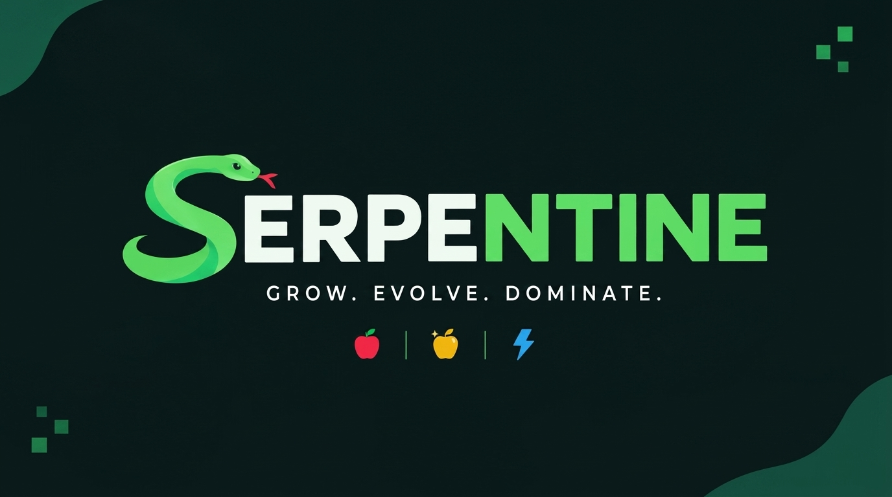

<p align="center">
  
</p>

<h1 align="center">🐍 SERPENTINE</h1>

<p align="center">
  <strong><em>GROW. EVOLVE. DOMINATE.</em></strong>
</p>

<p align="center">
  
  
  
  
  
  
  
  
</p>

---

## 📖 Description

**Serpentine** is a high-octane, cyberpunk-infused modern re-imagination of the classic arcade Snake game. Built natively for Android using **Jetpack Compose** and **Kotlin**, it pairs vintage 8-bit nostalgia with cutting-edge mobile graphics, real-time procedural chiptune sound generation, and tactile haptic feedback.

Whether you're dodging your own tail under the neon glow of the **Matrix Neon** grid or chilling with the nostalgic green tint of **Retro GameBoy**, Serpentine delivers an ultra-smooth, responsive arcade experience without bloated external assets or dependencies.

---

## 🏛️ Structure of Game

The project follows a clean, single-activity Compose architecture designed for high performance, zero-latency inputs, and predictable state transitions:

```text
Snake game/
├── app/
│   ├── src/main/
│   │   ├── java/com/example/snakegame/
│   │   │   └── MainActivity.kt        # Complete Game Engine & Compose UI
│   │   │       ├── 0. App Branding    # Identity, taglines & config
│   │   │       ├── 1. Data Models     # Point, Direction, Food, Difficulty & Enums
│   │   │       ├── 2. Theme Engine    # 4 Dynamic Palette definitions (Colors/Gradients)
│   │   │       ├── 3. Game Engine     # Tick loop, collision detection, food generator
│   │   │       ├── 4. Audio Engine    # Real-time AudioTrack procedural 8-bit synth
│   │   │       ├── 5. Haptics System  # Tactile vibrator feedback with settings toggle
│   │   │       ├── 6. Splash Screen   # Loading progress bar overlay
│   │   │       ├── 7. Game Canvas     # Hardware-accelerated Canvas & particle emitters
│   │   │       └── 8. Virtual D-Pad   # Ergonomic touch navigation controls
│   │   ├── res/                       # Vectors, icons, and localized strings
│   │   └── AndroidManifest.xml        # Permissions (VIBRATE) & portrait orientation
│   └── build.gradle.kts               # Dependencies, SDK targets (35) & Compose BOM
├── art/
│   └── banner.png                     # High-res GitHub banner asset
├── gradle/wrapper/                    # Gradle Wrapper binaries & properties
├── README.md                          # Project documentation
├── LICENSE                            # MIT Open Source License
└── .gitignore                         # Build artifact and local cache exclusion
```

---

## ✨ Features

- 🎨 **4 Immersive Visual Themes:**
  - **Matrix Neon:** Classic green terminal glow on obsidian black.
  - **Cyberpunk Pink:** Vibrant synthwave neon glow with deep purples.
  - **Retro GameBoy:** Nostalgic 90s handheld monochrome olive LCD matrix.
  - **Midnight Blue:** Deep space cyan and electric navy contrast.
- 🎵 **Procedural Retro Chiptune BGM:**
  - Real-time synthesized 8-bit arcade soundtrack powered by Android's low-level `AudioTrack`.
  - Zero bulky MP3 or WAV files; 100% generated on-the-fly via mathematical waveforms.
  - Dedicated sound toggle in settings.
- 📳 **Tactile Haptic Feedback:**
  - Distinct vibration patterns for turning, munching food, powerups, and wall crashes.
  - Dedicated toggle in Settings to stop vibration anytime.
- ⏳ **Animated Splash & Progress Bar:**
  - Smooth loading bar animation on app startup before presenting the main arena.
- 🕹️ **Dual Control System:**
  - Ergonomic on-screen **Virtual D-Pad** with directional arrow indicators.
  - Full-screen **Touch Gesture Swipe** controls for intuitive one-thumb gameplay.
- 🍎 **Dynamic Multi-Tier Food System:**
  - 🍎 **Normal Pellet (+1 pt):** Standard snake growth.
  - ✨ **Golden Apple (+5 pts):** Timed bonus fruit for rapid score boosts.
  - ⚡ **Speed Boost (+2 pts):** High-speed adrenaline rush.
- 💥 **Canvas Particle Explosions:**
  - Dynamic visual particle bursts upon collecting items and game-over collisions.
- 🏆 **Local High Score Tracking:**
  - Automatically preserves best runs and stats across game sessions.

---

## 🚀 How to Start

### Prerequisites
- **Android Studio** Ladybug (2024.2+) or newer.
- **JDK 17** or **JDK 21** configured as Gradle JVM.
- Android Device or Emulator running **Android 7.0 (Nougat / API 24)** or higher.

### Installation
1. **Clone the repository:**
   ```bash
   git clone https://github.com/Kashif-Mashi/SERPENTINE.git
   ```
2. **Open in Android Studio:**
   - Launch Android Studio and click **Open**.
   - Browse to the cloned directory and select it.
3. **Sync Project:**
   - Let Gradle download dependencies and sync the project.
4. **Run the App:**
   - Connect your Android phone via USB debugging or start an Android Virtual Device (AVD).
   - Press **Shift + F10** (or click the green **Run** ▶️ icon).

---

## 🎮 How to Play

1. **Launch & Start:**
   - Tap **Play** on the main menu to begin.
2. **Control your Snake:**
   - Use the **Virtual D-Pad** buttons at the bottom or **Swipe anywhere** across the grid.
3. **Survive & Score:**
   - Eat normal pellets (🍎) to grow longer.
   - Snag golden apples (✨) before they expire for huge bonus points.
   - Collect speed boosts (⚡) to accelerate the challenge.
4. **Avoid Collisions:**
   - Crashing into the perimeter walls or your own body ends the run.
5. **Customize Settings:**
   - Tap the **Gear** (⚙️) icon in the top-right corner to toggle sound, mute vibration, change difficulty, or switch color themes.

---

## 🤝 Contribution

Contributions make the open-source community a fantastic place to learn, inspire, and create! Any contributions you make are **greatly appreciated**.

1. **Fork the Project** (`https://github.com/Kashif-Mashi/SERPENTINE/fork`)
2. **Create your Feature Branch:**
   ```bash
   git checkout -b feature/AmazingFeature
   ```
3. **Commit your Changes:**
   ```bash
   git commit -m "Add some AmazingFeature"
   ```
4. **Push to the Branch:**
   ```bash
   git push origin feature/AmazingFeature
   ```
5. **Open a Pull Request** against the `main` branch.

---

## 📄 License

Distributed under the **MIT License**. See [`LICENSE`](LICENSE) for more information.
